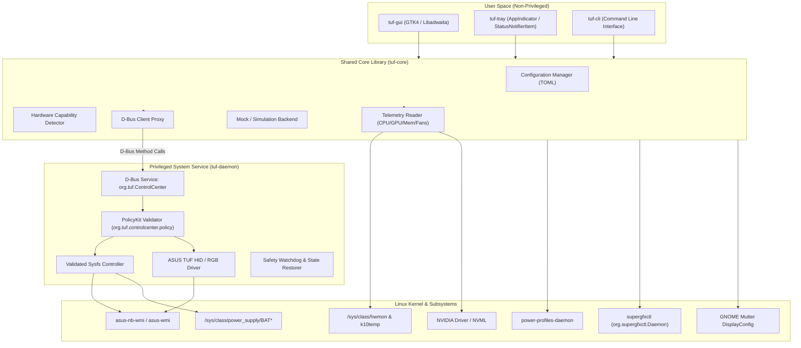

# System Architecture & Design

`TUF Control Center` follows a modern, modular, least-privilege Linux desktop architecture designed specifically for safety, testability, and responsiveness.

---

## 1. Component Separation

### 1.1 `tuf-core`
A pure Rust library providing:
- **Hardware Abstraction Layer (HAL)**: Trait `HardwareBackend` implemented by both `LinuxHardwareBackend` and `MockHardwareBackend`.
- **Telemetry Engine**: High-performance, zero-allocation parsing of `/proc/stat`, `/proc/meminfo`, `/sys/class/hwmon/`, and battery status.
- **Config Management**: Versioned TOML configuration stored in `$XDG_CONFIG_HOME/tuf-control-center/config.toml` with automatic validation and migration.
- **Hardware Registry**: Auto-detects laptop vendor and model (e.g. `ASUS TUF Gaming A15 FA506NC`) and builds a `HardwareCapabilities` struct.

### 1.2 `tuf-daemon`
A minimal, hardened system service running as root or with `CAP_SYS_ADMIN`:
- Exposes `org.tuf.ControlCenter` on the system D-Bus.
- Restricts actions using PolicyKit (`org.tuf.controlcenter.policy`), allowing desktop users in the `sudo` or `wheel` group to alter power and battery thresholds without entering a password, while preventing unauthorized network or guest users.
- Only executes strictly validated atomic operations (e.g., verifying that a battery threshold is exactly one of `60`, `80`, or `100`).
- No arbitrary command execution.
- Implements a heartbeat watchdog: in case of client crash or unhandled error, safe firmware thermal defaults are maintained.

### 1.3 `tuf-gui`
A native GTK4 application leveraging Libadwaita widgets (`AdwApplicationWindow`, `AdwPreferencesGroup`, `AdwActionRow`, `AdwViewStack`):
- Non-blocking asynchronous event loop via `glib::MainContext` and `tokio`.
- 100% theme integration with GNOME (automatic dark/light mode switching).
- Responsive layout adapting to both small and large window sizes.
- Real-time animated graphs for CPU/GPU temperatures and loads.

### 1.4 `tuf-cli`
A lightweight command-line tool allowing scripting, keybindings, and headless control:
- `tuf-cli profile [silent|balanced|turbo]`
- `tuf-cli battery-limit [60|80|100]`
- `tuf-cli gpu [hybrid|integrated]`
- `tuf-cli status --json`

---

## 2. Telemetry and Polling Architecture

To prevent CPU consumption and unnecessary battery drain:
- **Adaptive Polling Intervals**:
  - Main window open & active: 1000 ms.
  - Main window minimized or running only in tray: 5000 ms.
  - System on battery power: scales telemetry polling to 3000 ms (window active) or 10000 ms (tray).
- **dGPU Sleep Respect**:
  - The NVIDIA discrete GPU enters runtime D3cold when idle in Hybrid mode.
  - Telemetry checks `/sys/bus/pci/devices/0000:01:00.0/power/runtime_status` prior to invoking NVML queries.
  - If status is `suspended`, telemetry reports `0W / Inactive / D3cold` and skips NVML to prevent waking the GPU.

---

## 3. Communication Protocols

| Channel | Purpose | Security Context |
| :--- | :--- | :--- |
| **System D-Bus** | Privileged hardware changes (`SetPerformanceMode`, `SetBatteryLimit`, `SetKeyboardRGB`) | Authenticated via Polkit |
| **Session D-Bus** | Display refresh rate (`org.gnome.Mutter.DisplayConfig`), Audio (`PipeWire`), Touchpad | Current user session |
| **Direct sysfs Read** | Non-privileged sensor telemetry (`/sys/class/hwmon`, `/proc/stat`) | Read-only unprivileged access |
